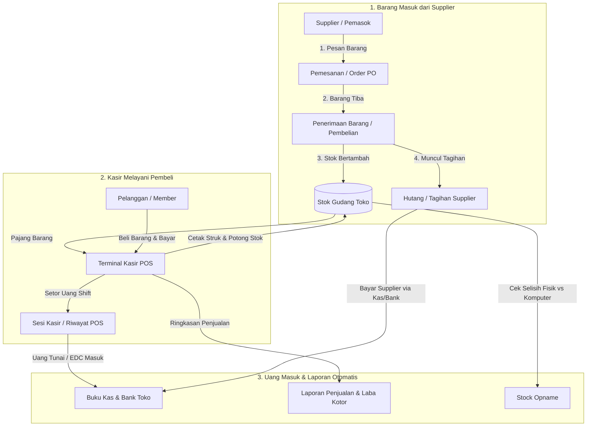
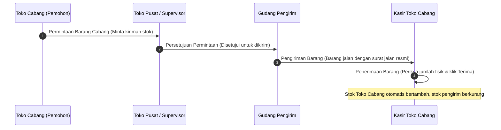

# 📖 Panduan Lengkap Fitur & Alur Kerja PAST-POS
> **Buku Panduan Operasional Toko Retail & Point of Sale (POS)**  
> *Ditulis dengan bahasa yang ramah, praktis, dan mudah dipahami oleh pemilik toko, kasir, supervisor, dan staf operasional.*

---

## 🧭 Daftar Isi
1. [Prinsip Dasar: Bagaimana PAST-POS Membantu Toko Anda](#-1-prinsip-dasar-bagaimana-past-pos-membantu-toko-anda)
2. [Peta Alur Kerja Toko (Bagaimana Semua Fitur Saling Terhubung)](#-2-peta-alur-kerja-toko-bagaimana-semua-fitur-saling-terhubung)
3. [Penjelasan Lengkap Setiap Modul & Fitur](#-3-penjelasan-lengkap-setiap-modul--fitur)
   - [A. Modul Kasir & Penjualan (Front Office)](#a-modul-kasir--penjualan-front-office)
   - [B. Modul Produk & Katalog Barang](#b-modul-produk--katalog-barang)
   - [C. Modul Persediaan & Stok (Inventory)](#c-modul-persediaan--stok-inventory)
   - [D. Modul Pengiriman Antar Cabang & Gudang](#d-modul-pengiriman-antar-cabang--gudang)
   - [E. Modul Pembelian ke Supplier (Purchasing)](#e-modul-pembelian-ke-supplier-purchasing)
   - [F. Modul Pelanggan, Member & Promosi](#f-modul-pelanggan-member--promosi)
   - [G. Modul Kas & Keuangan Toko (Finance)](#g-modul-kas--keuangan-toko-finance)
   - [H. Modul Karyawan & Hak Akses Pengguna](#h-modul-karyawan--hak-akses-pengguna)
   - [I. Modul Laporan Bisnis Toko](#i-modul-laporan-bisnis-toko)
   - [J. Modul Pengaturan Toko & Struk](#j-modul-pengaturan-toko--struk)
4. [Tabel Hubungan Antar Fitur (Matrix Keterkaitan)](#-4-tabel-hubungan-antar-fitur-matrix-keterkaitan)
5. [Skenario Nyata Sehari-Hari di Toko](#-5-skenario-nyata-sehari-hari-di-toko)

---

## 🌟 1. Prinsip Dasar: Bagaimana PAST-POS Membantu Toko Anda

Aplikasi **PAST-POS** dirancang sebagai sistem saraf pusat toko Anda. Setiap aksi yang dilakukan oleh staf di satu bagian akan **otomatis memperbarui** bagian lainnya tanpa perlu hitung manual:

1. **Kasir Scan Barang di Kasir (POS)** ➡️ **Stok Barang di Gudang otomatis berkurang detik itu juga**.
2. **Pelanggan Membayar** ➡️ **Uang otomatis tercatat di Laci Kasir (Sesi Kasir) dan Buku Kas Keuangan**.
3. **Barang Dagangan Hampir Habis** ➡️ **Sistem memberi tahu di Laporan Stok Kritis** agar Tim Pembelian segera memesan ke Supplier.
4. **Toko Punya Banyak Cabang** ➡️ **Stok bisa dikirim antar toko dengan surat jalan resmi dan verifikasi penerimaan barang**.

Semua data terintegrasi secara aman, rapi, dan transparan sehingga pemilik toko terhindar dari risiko barang hilang, selisih uang kasir, atau kehabisan stok barang terlaris.

---

## 🔄 2. Peta Alur Kerja Toko (Bagaimana Semua Fitur Saling Terhubung)

Berikut adalah gambaran visual sederhana bagaimana barang masuk, dijual oleh kasir, dan menghasilkan laporan keuangan:



---

## 🛠️ 3. Penjelasan Lengkap Setiap Modul & Fitur

---

### A. Modul Kasir & Penjualan (Front Office)
*Bagian ujung tombak toko untuk melayani transaksi pembeli dengan cepat dan akurat.*

#### 1. POS (Point of Sale / Terminal Kasir)
* **Apa fungsinya?** Layar kerja utama kasir toko. Kasir dapat memindai barcode produk dengan barcode scanner, memilih variasi produk, menambahkan diskon, memasukkan data pelanggan, dan menerima pembayaran (Tunai, QRIS, Debit, Kartu Kredit, Transfer).
* **Kapan digunakan?** Sepanjang hari saat melayani pembeli yang datang ke toko.
* **Hubungan dengan fitur lain:**
  - Mengambil data dari **Katalog Produk** (nama barang, barcode, harga jual).
  - Otomatis memotong **Stok Produk** di toko kasir yang sedang bertugas.
  - Memasukkan riwayat transaksi ke **Semua Penjualan** dan **Sesi Kasir**.

#### 2. Cek Harga & Stok (Price Checker)
* **Apa fungsinya?** Layar kilat untuk mengecek harga dan ketersediaan stok barang hanya dengan memindai barcode, tanpa perlu masuk ke transaksi kasir.
* **Kapan digunakan?** Saat pembeli bertanya harga suatu barang atau staf toko sedang merapikan rak display.
* **Hubungan dengan fitur lain:** Menampilkan data langsung dari **Katalog Produk & Stok**.

#### 3. Riwayat POS (Sesi Kasir / Sales Session)
* **Apa fungsinya?** Mencatat buka-tutup shift kasir. Saat kasir mulai bertugas (buka kasir), kasir memasukkan modal awal laci kasir (uang receh kembalian). Saat tutup kasir, kasir menghitung total uang fisik di laci dan mencocokkannya dengan catatan komputer.
* **Kapan digunakan?** Setiap pergantian shift kerja kasir atau saat toko tutup di malam hari.
* **Hubungan dengan fitur lain:**
  - Mencegah kecurangan atau selisih uang kasir.
  - Total omset shift kasir akan disetorkan ke **Kas & Bank Toko**.

#### 4. Semua Penjualan (Sales Order)
* **Apa fungsinya?** Buku induk seluruh transaksi penjualan yang pernah terjadi di toko. Dilengkapi dengan **Tab Filter Interaktif**:
  - `[Semua Transaksi]`: Menampilkan total semua penjualan.
  - `[Kasir (POS)]`: Khusus nota transaksi yang diproses di mesin kasir fisik toko.
  - `[Manual]`: Penjualan partai/grosir via WhatsApp, telepon, atau nota kantor.
  - `[Deposit]`: Penjualan dengan sistem uang muka (titip saldo).
  - `[Import]`: Transaksi massal yang dimasukkan lewat berkas Excel.
* **Fitur Tambahan:** Tombol **Cetak Struk Thermal ulang** jika kertas struk kasir habis/macet, dan **Export Excel** untuk rekapan ke pemilik toko.

#### 5. Retur Penjualan (Sales Return)
* **Apa fungsinya?** Mencatat pengembalian barang dari pembeli (karena barang cacat, salah beli, atau kedaluwarsa).
* **Kapan digunakan?** Saat ada komplain pembeli yang disetujui toko.
* **Hubungan dengan fitur lain:** Barang yang diretur akan otomatis **kembali menambah stok gudang** (jika barang masih layak) dan sistem mengembalikan uang atau menerbitkan nota kredit.

---

### B. Modul Produk & Katalog Barang
*Pusat informasi semua barang dagangan yang dijual oleh toko Anda.*

#### 1. Semua Produk (Product)
* **Apa fungsinya?** Tempat mendaftarkan barang baru yang akan dijual. Di sini Anda mengisi nama barang, kode barcode/SKU, kategori, satuan (Pcs, Box, Pack), harga modal (HPP), dan harga jual ke konsumen.
* **Hubungan dengan fitur lain:** Menjadi sumber data utama bagi **Kasir POS**, **Pemesanan Pembelian**, dan **Laporan Stok**.

#### 2. Kategori Produk (Group) & Divisi (Division)
* **Apa fungsinya?** Mengelompokkan barang agar rapi dan mudah dicari. Contoh: Kategori *Minuman*, *Makanan Ringan*, *Sembako*, *Peralatan Mandi*.
* **Hubungan dengan fitur lain:** Memudahkan kasir mencari barang di layar POS dan memudahkan melihat laporan *kategori mana yang paling laku*.

#### 3. Satuan Ukuran (UOM / Unit of Measure)
* **Apa fungsinya?** Mengatur ukuran satuan barang, seperti *Pcs, Botol, Lusin, Dus, Kilogram*. Toko juga bisa mengatur konversi (contoh: 1 Dus = 24 Botol).

#### 4. Produk Dibawah Minimum (Minimum Stock)
* **Apa fungsinya?** Alarm peringatan otomatis yang menampilkan daftar barang yang stoknya sudah menipis di bawah batas aman yang sudah ditentukan toko.
* **Kapan digunakan?** Dipantau setiap hari oleh bagian gudang atau bagian pembelian untuk segera memesan barang lagi sebelum kehabisan di toko.

#### 5. Perubahan Harga (Product Price Adjustment)
* **Apa fungsinya?** Mengubah harga jual banyak barang sekaligus secara terjadwal atau saat ada kenaikan harga dari pabrik.

---

### C. Modul Persediaan & Stok (Inventory)
*Pusat kendali barang dagangan toko. Memastikan jumlah barang di rak toko sama persis dengan angka yang ada di komputer, mencatat riwayat perpindahan barang, serta mengaudit barang fisik secara berkala.*

#### 1. Laporan Perpindahan Barang (Stock Movement / Kartu Mutasi Stok)
* **Apa itu Stock Movement?**  
  Bayangkan **Stock Movement** seperti **Buku Tabungan / Rekening Koran** untuk setiap barang dagangan Anda. Di buku tabungan uang, ada uang masuk, uang keluar, dan sisa saldo. Begitu pula di Stock Movement:
  - **Stok Masuk (+):** Berasal dari Pembelian ke Supplier, Retur Pengembalian dari Pembeli, atau Kiriman Transfer dari Cabang lain.
  - **Stok Keluar (-):** Berasal dari Penjualan Kasir di POS, Retur Barang Rusak ke Supplier, Kiriman Transfer ke Toko Cabang lain, atau Barang Rusak/Hilang yang dibuang.
  - **Saldo Sisa:** Jumlah riil barang yang seharusnya ada di toko pada detik tersebut.
* **Informasi apa saja yang tercatat di Stock Movement?**
  - **Tanggal & Jam:** Kapan pergerakan barang terjadi.
  - **Nomor Dokumen:** Nomor nota kasir, nomor surat jalan penerimaan supplier, atau nomor faktur transfer cabang.
  - **Tipe Transaksi:** Keterangan apakah barang bergerak karena *Jual Kasir*, *Beli Supplier*, *Opname*, atau *Transfer*.
  - **Stok Awal ➡️ Masuk/Keluar ➡️ Stok Akhir**.
* **Kapan fitur ini digunakan?**
  - Saat Anda curiga: *"Kenapa di sistem tercatat sisa 5 botol, padahal kemarin ada 10 botol?"* Anda tinggal membuka kartu Stock Movement produk tersebut dan melihat riwayatnya: siapa yang menjual, jam berapa, dan dengan nomor nota kasir berapa. Sangat ampuh untuk melacak kebocoran barang!

---

#### 2. Stock Opname (SO / Audit Fisik Barang Toko)
* **Apa itu Stock Opname?**  
  Stock Opname adalah kegiatan rutin toko (biasanya dilakukan seminggu sekali, sebulan sekali, atau saat pergantian musim) di mana staf toko **menghitung secara manual satu per satu barang fisik yang ada di rak pajangan dan gudang**, lalu mencocokkannya dengan angka yang ada di komputer.
* **Mengapa Stock Opname Sangat Penting di Bisnis Retail?**  
  Di toko fisik sehari-hari, sering kali terjadi hal-hal tak terduga: barang jatuh pecah tapi staf lupa lapor, pembeli memasukkan barang ke saku (pencurian/shrinkage), kasir salah scan barcode (misal rasa cokelat discan rasa vanila), atau bonus barang dari supplier belum diinput. Tanpa Stock Opname, data stok komputer akan kacau dan toko bisa merugi tanpa disadari!
* **Alur Langkah demi Langkah Menjalankan Stock Opname di PAST-POS:**
  ```mermaid
  flowchart LR
      A[1. Buka Jadwal SO<br>Pilih Toko / Kategori] --> B[2. Hitung Fisik Rak<br>Input Jumlah Fisik Nyata]
      B --> C[3. Sistem Cek Selisih<br>Fisik vs Komputer]
      C --> D[4. Persetujuan Owner / SPV<br>Validasi Hasil Hitung]
      D --> E[5. Posting Penyesuaian<br>Stok Komputer Dikalibrasi]
  ```
  1. **Buat Formulir Opname (`stockopname`):** Tentukan toko/cabang dan kategori produk yang akan dihitung (bisa seluruh barang toko atau sebagian kategori per hari).
  2. **Hitung Fisik Barang:** Staf toko memegang lembar hitung fisik atau membawa barcode scanner portabel untuk menghitung jumlah nyata di rak.
  3. **Input Angka Fisik ke Sistem:** Masukkan angka hasil hitungan nyata ke aplikasi.
  4. **Analisis Selisih Otomatis oleh Sistem:**
     - **Selisih Nol (0):** Sempurna! Stok rak fisik sama persis dengan komputer.
     - **Selisih Minus (-):** Barang fisik kurang dari komputer (indikasi hilang, rusak tidak terdata, atau kasir salah scan).
     - **Selisih Plus (+):** Barang fisik lebih banyak dari komputer (indikasi barang datang belum diinput atau kasir lupa scan saat menjual).
  5. **Konfirmasi & Kalibrasi:** Setelah disetujui Manajer/Owner, sistem otomatis mengupdate angka stok komputer agar kembali akurat sama dengan stok fisik di rak.

---

#### 3. Penyesuaian Stok (Stock Adjustment)
* **Apa fungsinya?**  
  Fitur untuk mengoreksi angka stok secara langsung di luar penjualan dan pembelian.
* **Kapan digunakan?**
  - **Barang Rusak (Damage):** Barang jatuh, kaleng penyok, bungkus robek digigit tikus sehingga tidak bisa dijual.
  - **Kedaluwarsa (Expired):** Makanan/minuman yang melewati tanggal kedaluwarsa dan harus dibuang.
  - **Konsumsi Internal Toko:** Contohnya toko memakai 1 botol sabun cuci piring dari rak sendiri untuk operasional wastafel toko.
  - **Koreksi Saldo Awal:** Saat toko baru pertama kali menggunakan aplikasi PAST-POS dan memasukkan stok awal toko.
* **Hubungan dengan Keuangan:**  
  Setiap barang yang disesuaikan karena rusak/hilang akan otomatis dicatat sebagai **Biaya Kerugian Barang (Beban Toko)** pada Laporan Laba/Rugi, sehingga pembukuan modal toko tetap seimbang.

---

#### 4. Tukar Stok (Exchange Stock)
* **Apa fungsinya?**  
  Fitur khusus saat ada penukaran barang sejenis antar varian (misal tukar ukuran Baju M ke L karena salah ambil, atau tukar barang retur dari pembeli yang langsung diganti barang baru dari rak).
* **Hubungan dengan fitur lain:**  
  Mengurangi 1 unit stok barang pengganti dan menambah kembali 1 unit stok barang yang ditukar, menjaga nilai persediaan toko tetap konsisten.

---

#### 5. Stok Produk & Stok Produk Per Cabang (`stockproduct` & `stockproductwarehouse`)
* **Apa fungsinya?**  
  Layar monitor stok utama. Menampilkan ringkasan cepat:
  - Berapa total stok barang di seluruh jaringan toko.
  - Rincian stok per lokasi: Toko Utama, Toko Cabang 1, Toko Cabang 2, dan Gudang Transit.
  - Status stok: *Aman*, *Kritis (Hampir Habis)*, atau *Kosong*.

---

#### 6. Export Data Stok (`exportdatastock`)
* **Apa fungsinya?**  
  Mengunduh seluruh daftar stok beserta nilai rupiahnya ke dalam format Excel (XLS/CSV) dengan satu klik.
* **Kapan digunakan?**  
  Saat pemilik toko ingin menganalisis total nilai persediaan bersama akuntan atau mencetak daftar stok untuk rapat bulanan.

---

---

### D. Modul Pengiriman Antar Cabang & Gudang
*Sangat berguna bagi pemilik bisnis yang memiliki lebih dari satu toko atau memiliki gudang penyimpanan terpisah.*

#### 1. Alur Resmi Transfer Cabang:


1. **Permintaan Barang Cabang (`requestgoodsbranch`)**: Kasir cabang membuat daftar barang apa saja yang mulai habis di tokonya dan meminta kiriman dari pusat.
2. **Persetujuan Permintaan Cabang (`approvalrequestgoodsbranch`)**: Manajer gudang/pemilik memeriksa apakah barang yang diminta tersedia dan menyetujui kuantitasnya.
3. **Pengiriman Barang Cabang (`deliveryorderbranch`)**: Bagian gudang mencetak Surat Jalan resmi dan memberangkatkan barang.
4. **Penerimaan Barang Cabang (`receivegoodbranch`)**: Kasir cabang menerima fisik barang, menghitung jumlah yang datang, dan menekan tombol konfirmasi. Stok cabang otomatis bertambah.

#### 2. Transfer Gudang Cabang By-Pass (`warehousetransferbranch`)
* **Apa fungsinya?** Fitur jalan pintas jika staf segera memindahkan barang secara darurat tanpa perlu menunggu alur 4 tahap di atas.

---

### E. Modul Pembelian ke Supplier (Purchasing)
*Mengelola proses belanja barang dagangan ke distributor atau supplier resmi.*

#### 1. Supplier (Pemasok)
* **Apa fungsinya?** Buku kontak rekanan supplier (Nama PT/Pemasok, nomor telepon, alamat, nomor rekening bank, dan batas tempo hutang/TOP).

#### 2. Pemesanan Barang / Purchase Order (PO - `purchasenew3`)
* **Apa fungsinya?** Membuat surat pesanan resmi kepada supplier sebelum barang dikirim. Mencegah supplier salah kirim jenis barang atau salah cantum harga.

#### 3. Persetujuan Pemesanan (`pemesananapproval`)
* **Apa fungsinya?** Kontrol otorisasi bagi pemilik toko atau manajer untuk menyetujui surat pesanan pembelian sebelum dikirim ke supplier.

#### 4. Penerimaan Pembelian (`purchasenew4`)
* **Apa fungsinya?** Saat pesanan barang dari supplier tiba di toko, staf memeriksa barang fisik lalu mencatatnya di sistem.
* **Hubungan dengan fitur lain:**
  - Otomatis **menambah stok barang dagangan** di gudang.
  - Memperbarui harga modal rata-rata (HPP).
  - Menerbitkan **Tagihan Supplier**.

#### 5. Tagihan Supplier & Pembayaran Hutang
* **Apa fungsinya?** Mengontrol kewajiban hutang toko ke supplier yang harus dibayar (bisa pembayaran tempo 14 hari, 30 hari, atau langsung lunas). Saat dibayar, uang kas toko di modul **Kas & Bank** otomatis berkurang.

#### 6. Retur Pembelian (`purchasereturnnew`)
* **Apa fungsinya?** Mengembalikan barang yang rusak atau salah kirim kembali ke supplier dan memotong jumlah hutang toko kepada supplier tersebut.

---

### F. Modul Pelanggan, Member & Promosi
*Meningkatkan loyalitas pelanggan agar betah berbelanja berulang kali di toko Anda.*

#### 1. Pelanggan & Grup Pelanggan
* **Apa fungsinya?** Menyimpan data pembeli setia (Nama, No HP, Alamat). Anda bisa membedakan grup: *Pelanggan Umum*, *Member Silver*, *Grosir/Kulakan*.
* **Manfaat:** Pelanggan grosir bisa otomatis mendapatkan harga khusus yang lebih murah daripada pembeli eceran saat barcode discan di kasir.

#### 2. Membership
* **Apa fungsinya?** Sistem kartu keanggotaan toko. Pembeli mengumpulkan poin setiap berbelanja kelipatan tertentu dan poin tersebut bisa ditukarkan menjadi diskon belanja di kasir.

#### 3. Promo Toko & Potongan Harga (Voucher)
* **Apa fungsinya?** Membuat program diskon fleksibel:
  - Diskon nominal (contoh: Potongan Rp 10.000).
  - Diskon persentase (contoh: Diskon 20% khusus hari Jumat).
  - Promo khusus produk tertentu (contoh: Beli 2 gratis 1).
* **Hubungan dengan fitur lain:** Saat kasir memasukkan kupon atau memilih produk promo, potongan harga otomatis terpasang di struk belanja.

---

### G. Modul Kas & Keuangan Toko (Finance)
*Mengawasi arus keluar masuk uang toko agar laba bersih toko tercatat jelas.*

#### 1. Bank & Rekening Toko
* **Apa fungsinya?** Mencatat saldo rekening toko (misal: Rekening BCA Toko, BRI, Mandiri, atau Dompet Digital QRIS).

#### 2. Pendapatan Lainnya (`income` / `otherincome`)
* **Apa fungsinya?** Mencatat pemasukan di luar penjualan barang toko. Contoh: Uang titipan sewa etalase, jasa pasang/service, atau bonus target dari pabrik.

#### 3. Biaya Operasional Toko (`expense`)
* **Apa fungsinya?** Mencatat pengeluaran harian toko yang diambil dari kas laci atau rekening toko.
* **Contoh penggunaan:** Membeli kertas struk kasir, kantong plastik kresek, bayar listrik/air toko, konsumsi karyawan, bensin pengiriman.
* **Manfaat:** Pemilik toko bisa melihat apakah biaya operasional toko bulan ini membengkak atau hemat.

#### 4. Buku Kas & Laba / Rugi (Income Statement)
* **Apa fungsinya?** Laporan kesehatan finansial otomatis:
  $$\text{Omset Penjualan} - \text{Modal Barang (HPP)} - \text{Biaya Operasional Toko} = \mathbf{Laba\ Bersih\ Toko}$$
  Pemilik toko tidak perlu lagi menyewa akuntan rumit hanya untuk mengetahui apakah toko untung atau rugi setiap bulannya.

---

### H. Modul Karyawan & Hak Akses Pengguna
*Menjamin keamanan sistem dan membagi wewenang kerja staf toko.*

#### 1. Karyawan / Staf Toko (`employee`)
* **Apa fungsinya?** Daftar profil staf toko (Nama, No HP, Alamat, Status Bekerja).

#### 2. Akun Pengguna (`user`) & Hak Akses (`group`)
* **Apa fungsinya?** Mengatur username dan kata sandi untuk login ke aplikasi, serta membatasi menu apa saja yang boleh dibuka oleh masing-masing jabatan:
  - **Kasir:** Hanya boleh membuka menu *Terminal Kasir POS* dan *Cek Harga*. Kasir tidak boleh melihat laporan keuangan, tidak boleh mengubah harga modal, dan tidak boleh menghapus transaksi.
  - **Supervisor / Kepala Toko:** Boleh melakukan *Stock Opname*, menyetujui retur, dan melihat laporan penjualan harian.
  - **Owner / Pemilik Toko (Super Admin):** Memiliki akses penuh ke semua modul dan laporan keuangan.

---

### I. Modul Laporan Bisnis Toko
*Mata dan telinga pemilik bisnis untuk mengambil keputusan tepat.*

| Nama Laporan | Isi Informasi | Manfaat Bagi Pemilik Toko |
| :--- | :--- | :--- |
| **Riwayat Penjualan (`saleshistory`)** | Rincian setiap struk belanja, jam ramai toko, kasir yang bertugas, metode pembayaran. | Mengetahui jam-jam sibuk toko sehingga bisa mengatur jadwal jaga kasir dengan optimal. |
| **Laporan HPP & Margin (`reporthpp`)** | Keuntungan kotor dari setiap produk yang terjual. | Mengetahui produk mana yang margin untungnya paling tebal. |
| **Slow Moving (`slowmoving`)** | Daftar barang yang jarang laku atau sudah berbulan-bulan mengendap di rak. | Pemilik toko tahu barang mana yang perlu segera didiskon/dijual promo agar modal tidak macet. |
| **Nilai Persediaan (`reportstockwarehouse`)** | Total nilai uang yang sedang tertanam dalam bentuk barang di gudang. | Mengetahui aset barang toko untuk evaluasi modal kerja. |
| **Laporan Penyesuaian (`adjustmenthistory`)** | Rekam jejak barang rusak, hilang, atau selisih saat stock opname. | Menekan risiko kecurangan dan kebocoran barang di toko. |

---

### J. Modul Pengaturan Toko & Struk
*Personalisasi identitas toko.*

#### 1. Pengaturan Toko (`store`) & Umum (`config`)
* **Apa fungsinya?** Mengatur Nama Toko, Alamat Lengkap, Nomor WhatsApp, dan Logo yang akan tercetak di bagian atas kertas struk kasir.
* **Pesan Kaki Struk (Footer):** Anda bisa menulis pesan seperti: *"Barang yang sudah dibeli tidak dapat ditukar"*, atau *"Terima kasih sudah berbelanja di Toko Berkah"*.

#### 2. Metode Pembayaran (`paymentmethod`)
* **Apa fungsinya?** Mengaktifkan pilihan pembayaran apa saja yang diterima di kasir toko: Tunai, QRIS BCA, EDC Mandiri, ShopeePay, GoPay, atau Transfer Bank.

---

## 🔗 4. Tabel Hubungan Antar Fitur (Matrix Keterkaitan)

Tabel berikut menunjukkan bagaimana sebuah tindakan pada satu fitur mempengaruhi fitur lainnya di dalam sistem PAST-POS:

| Aksi yang Dilakukan Pengguna | Fitur yang Terpengaruh Langsung | Dampak Otomatis di Sistem |
| :--- | :--- | :--- |
| **Kasir memproses belanja di Terminal POS** | 1. Stok Produk<br>2. Riwayat POS<br>3. Semua Penjualan<br>4. Laporan Penjualan | • Stok barang otomatis terpotong saat itu juga.<br>• Uang kasir bertambah di sesi shift.<br>• Data tersimpan di arsip nota penjualan.<br>• Laporan omset harian langsung naik. |
| **Gudang menerima barang dari Supplier** | 1. Stok Produk<br>2. Tagihan Supplier<br>3. Kartu Riwayat Pembelian | • Stok fisik barang bertambah siap dijual kasir.<br>• Muncul kewajiban hutang toko ke supplier.<br>• Harga modal (HPP) diperbarui. |
| **Toko mentransfer barang ke Toko Cabang** | 1. Stok Toko Asal<br>2. Stok Toko Tujuan<br>3. Laporan Mutasi Stok | • Stok di gudang pengirim berkurang.<br>• Stok di cabang penerima bertambah setelah dikonfirmasi.<br>• Jejak surat jalan tercatat rapi. |
| **Kasir mengeluarkan uang laci untuk beli lakban/kresek** | 1. Kas & Bank<br>2. Biaya Operasional Toko<br>3. Laporan Laba Rugi | • Saldo uang laci berkurang.<br>• Beban operasional toko bertambah.<br>• Laba bersih toko bulan berjalan dihitung ulang. |
| **Pelanggan meretur barang rusak** | 1. Retur Penjualan<br>2. Stok Produk<br>3. Kas Toko | • Struk retur diterbitkan.<br>• Stok bertambah (jika layak kembali).<br>• Uang kasir keluar untuk pengembalian dana pembeli. |
| **Kepala Toko menyelesaikan Stock Opname** | 1. Penyesuaian Stok<br>2. Stok Produk<br>3. Laporan Selisih | • Angka stok komputer dikalibrasi sesuai fisik rak.<br>• Barang hilang/rusak dicatat sebagai biaya selisih. |

---

## 🏪 5. Skenario Nyata Sehari-Hari di Toko

Berikut adalah gambaran praktis bagaimana staf toko menggunakan aplikasi PAST-POS dari toko buka hingga tutup:

### ☀️ Pagi Hari (Toko Baru Buka)
1. **Kasir Datang & Login:** Kasir membuka menu **POS**, sistem meminta mengisi modal awal (misal uang kembalian Rp 100.000). Kasir klik **Buka Sesi Kasir**.
2. **Kepala Toko Cek Stok Menipis:** Kepala Toko membuka menu **Dibawah Minimum**. Dilihat bahwa Minyak Goreng sisa 2 dus. Kepala Toko langsung membuka menu **Pemesanan (PO)** untuk memesan 10 dus ke Supplier.

### 🌤️ Siang Hari (Operasional Berjalan)
1. **Transaksi Ramai:** Kasir melayani puluhan pembeli menggunakan barcode scanner di layar **POS**. Pembeli membayar tunai dan QRIS. Struk belanja tercetak lancar.
2. **Barang Kiriman Tiba:** Truk supplier datang membawa pesanan Minyak Goreng. Bagian gudang membuka menu **Pembelian**, mencocokkan surat jalan supplier dengan pesanan, lalu klik **Terima Barang**. Stok Minyak Goreng bertambah otomatis.
3. **Ada Pengeluaran Toko:** Staf membeli air galon toko seharga Rp 20.000. Kasir/Admin mencatatnya di menu **Biaya Operasional Toko** dengan kategori *Konsumsi Toko*.

### 🌙 Malam Hari (Toko Tutup & Tutup Kasir)
1. **Tutup Kasir (End of Shift):** Kasir menghitung uang fisik di laci kasir (misal uang tunai terkumpul Rp 3.250.000 + bukti struk EDC Rp 1.500.000). Kasir membuka menu **Riwayat POS** lalu klik **Tutup Sesi**. Sistem mencocokkan: *Hasil fisik vs Rekapan sistem seimbang (Selisih Rp 0)*.
2. **Pemilik Toko Memantau dari Rumah:** Pemilik toko membuka menu **Dashboard** dan **Laporan Penjualan** dari ponsel atau laptop. Pemilik toko tersenyum melihat omset hari ini, laba kotor yang didapat, dan sisa stok barang tanpa perlu menelepon kasir satu per satu.

---

> **💡 Tips Sukses Pengelolaan Toko dengan PAST-POS:**
> - Selalu biasakan kasir melakukan **Buka Shift** dan **Tutup Shift** setiap hari agar uang toko tidak pernah selisih.
> - Lakukan **Stock Opname** secara rutin (misal setiap akhir pekan untuk 1 kategori barang secara bergantian) agar rak toko selalu sinkron dengan sistem.
> - Pastikan setiap biaya operasional sekecil apa pun selalu dicatat di menu **Biaya**, agar angka keuntungan bersih toko di akhir bulan akurat 100%.
