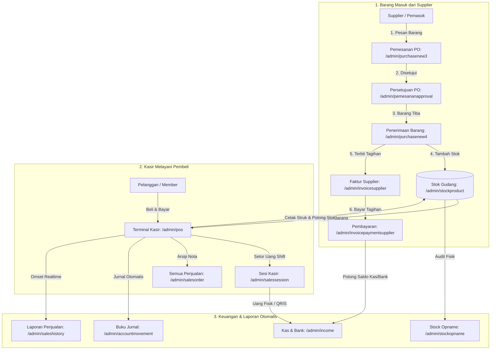

# 📖 Panduan Lengkap Fitur & Alur Kerja PAST-POS
> **Buku Panduan Operasional Toko Retail & Point of Sale (POS)**  
> *Ditulis dengan bahasa yang ramah, praktis, dan terstruktur sesuai struktur menu resmi aplikasi PAST-POS.*

---

## 🧭 Daftar Isi
1. [Prinsip Dasar: Bagaimana PAST-POS Membantu Toko Anda](#-1-prinsip-dasar-bagaimana-past-pos-membantu-toko-anda)
2. [Peta Alur Kerja Toko (End-to-End Retail Flow)](#-2-peta-alur-kerja-toko-end-to-end-retail-flow)
3. [Daftar Lengkap Menu & Modul Sistem (Navigasi Sidebar Resmi)](#-3-daftar-lengkap-menu--modul-sistem-navigasi-sidebar-resmi)
   - [A. Dashboard & Statistik](#a-dashboard--statistik)
   - [B. Kasir POS & Cek Harga Cepat](#b-kasir-pos--cek-harga-cepat)
   - [C. Modul Penjualan (Sales)](#c-modul-penjualan-sales)
   - [D. Modul Pembelian (Purchasing)](#d-modul-pembelian-purchasing)
   - [E. Modul Persediaan (Inventory)](#e-modul-persediaan-inventory)
   - [F. Modul Keuangan & Akuntansi (Finance)](#f-modul-keuangan--akuntansi-finance)
   - [G. Modul HR & Kepegawaian](#g-modul-hr--kepegawaian)
   - [H. Laporan & Analitik Bisnis](#h-laporan--analitik-bisnis)
   - [I. Pengaturan Sistem (Settings)](#i-pengaturan-sistem-settings)
4. [Tabel Hubungan Antar Fitur (Matrix Keterkaitan)](#-4-tabel-hubungan-antar-fitur-matrix-keterkaitan)
5. [Skenario Nyata Sehari-Hari di Toko](#-5-skenario-nyata-sehari-hari-di-toko)
6. [Data Simulasi & Pengujian Fitur (`FeatureSimulationSeeder`)](#-6-data-simulasi--pengujian-fitur-featuresimulationseeder)
7. [Perintah Utilitas & Sinkronisasi Database (`SyncDatabaseSequences`)](#-7-perintah-utilitas--sinkronisasi-database-syncdatabasesequences)

---

## 🌟 1. Prinsip Dasar: Bagaimana PAST-POS Membantu Toko Anda

Aplikasi **PAST-POS** dirancang sebagai sistem saraf pusat toko Anda. Setiap aksi yang dilakukan oleh staf di satu bagian akan **otomatis memperbarui** bagian lainnya tanpa perlu hitung manual:

1. **Kasir Scan Barang di Layar POS** ➡️ **Stok Barang di Gudang otomatis terpotong detik itu juga**.
2. **Pelanggan Membayar (Tunai/QRIS/Debit)** ➡️ **Uang otomatis tercatat di Laci Kasir (Sesi Shift) dan Buku Kas Keuangan**.
3. **Barang Dagangan Menipis** ➡️ **Sistem memberi peringatan di menu Stok Menipis** agar Tim Pembelian segera membuat PO ke Supplier.
4. **Penerimaan Barang Supplier Tiba** ➡️ **Stok bertambah, harga beli tercatat, dan muncul invoice hutang usaha**.
5. **Toko Punya Banyak Cabang** ➡️ **Stok bisa dikirim antar toko dengan surat jalan resmi dan verifikasi penerimaan barang**.

---

## 🔄 2. Peta Alur Kerja Toko (End-to-End Retail Flow)



---

## 🛠️ 3. Daftar Lengkap Menu & Modul Sistem (Navigasi Sidebar Resmi)

Berikut adalah daftar menu lengkap sesuai struktur sidebar aplikasi PAST-POS:

---

### A. Dashboard & Statistik
Pusat kontrol visual untuk memantau performa toko secara *realtime*.

1. **Dashboard Penjualan (`/admin/dashboardsales`)**
   - **Fungsi:** Menampilkan grafik omset harian/bulanan, total transaksi, rata-rata belanja konsumen, pelanggan teratas (*top revenue*), dan produk terlaris (*top product*).
   - **Kapan digunakan:** Setiap saat oleh pemilik toko (*owner*), supervisor, dan manajer cabang.
2. **Dashboard Inventori (`/admin/dashboardinventory`)**
   - **Fungsi:** Menampilkan ringkasan total mutasi stok antar cabang, nominal transfer barang, dan persentase penyelesaian transfer fisik.

---

### B. Kasir POS & Cek Harga Cepat
Terminal garis depan pelayanan transaksi kasir.

1. **Kasir POS (`/admin/pos`)**
   - **Fungsi:** Layar transaksi kasir cepat. Mendukung pemindaian barcode hardware, pencarian produk responsif (`minLength: 2`), pemilihan pelanggan member, multi-voucher promo, kalkulasi PPN, dan opsi multi-metode pembayaran (Tunai, QRIS, Transfer BCA, Kartu Debit, Split-Payment).
   - **Kapan digunakan:** Sepanjang jam operasional toko oleh kasir bertugas.
2. **Cek Harga & Stok Cepat (`/admin/pricechecker`)**
   - **Fungsi:** Layar mandiri untuk mengecek harga jual dan posisi stok rak dengan memindai barcode tanpa mengganggu transaksi kasir aktif.

---

### C. Modul Penjualan (Sales)
Manajemen lengkap transaksi penjualan, riwayat shift, pelanggan, dan promosi.

#### 1. Transaksi Penjualan
- **Semua Penjualan (`/admin/salesorder`)**: Arsip induk seluruh nota transaksi (POS, Manual, Deposit/DP, dan Import Excel) lengkap dengan rincian item, diskon, cetak ulang struk, dan status pelunasan.
- **Jurnal Penjualan (`/admin/salesjournal`)**: Rekapitulasi nilai pembukuan penjualan harian per cabang toko.
- **Riwayat Sesi Kasir / Shift (`/admin/salessession`)**: Monitoring buka-tutup shift kasir, pencatatan kas modal awal (*open balance*), rekonsiliasi uang fisik di laci kasir vs hitungan komputer saat tutup toko (*closing*).
- **Detail Transaksi Sesi Kasir (`/admin/salessessiondetail`)**: Rincian seluruh struk nota yang diterbitkan pada shift kasir tertentu beserta rincian metode pembayaran yang diterima.
- **Rekap Kas Masuk / Keluar Kasir (`/admin/salessessioncash`)**: Laporan audit arus kas fisik laci kasir per shift.
- **Rekap Pembayaran Non-Tunai (`/admin/salessessionnontunai`)**: Rekapitulasi pembayaran digital kasir (QRIS, Kartu Debit, Transfer Bank).
- **Koreksi Transaksi Kasir (`/admin/salesorderpos`)**: Menu pembatalan atau koreksi nota penjualan kasir jika terjadi salah input kasir.
- **Scan Resi Pengiriman (`/admin/scandelivery`)**: Pemindaian resi surat jalan pesanan kiriman pelanggan.
- **Target Penjualan Cabang & Brand**:
  - Periode Target Mingguan (`/admin/week`)
  - Grup Target Penjualan (`/admin/configmastergroup`)
  - Target Omset Brand (`/admin/configtargetbrand`)

#### 2. Manajemen Pelanggan & Member
- **Kategori Pelanggan (`/admin/customergroup`)**: Pengelompokan pelanggan (misal *Pelanggan Umum*, *Member Gold*, *Reseller/Grosir*).
- **Data Pelanggan (`/admin/customer`)**: Basis data pelanggan (nama, nomor WhatsApp, alamat, saldo deposit).
- **Program Promosi & Kampanye (`/admin/campaign`)**: Pembuatan program undian berhadiah atau kampanye kupon berjangka.
- **Laporan Program Promosi (`/admin/reportcampaign`)**: Analitik keberhasilan kampanye promosi toko.
- **Klaim Garansi Produk**:
  - Kategori Klaim Garansi (`/admin/claimtype`)
  - Persetujuan Klaim Garansi (`/admin/claimapproval`)
- **Program Keanggotaan Member (`/admin/membership`)**: Daftar member aktif, akumulasi poin reward, dan masa aktif membership.

#### 3. Promo & Voucher Diskon
- **Daftar Promosi Toko (`/admin/promotion`)**: Pengaturan diskon persentase, diskon nominal, grosir bertingkat, atau beli A gratis B dengan pembatasan jam dan hari.
- **Voucher & Kupon Diskon (`/admin/voucher`)**: Pembuatan kode voucher belanja unik untuk pelanggan.

---

### D. Modul Pembelian (Purchasing)
Pengelolaan pengadaan barang, hubungan supplier, hutang usaha, dan tagihan cabang.

#### 1. Pemasok (Supplier)
- **Daftar Supplier (`/admin/supplier`)**: Master data vendor penyedia barang (nama PT/CV, kontak sales, alamat pabrik, termin pembayaran).

#### 2. Transaksi Pembelian & Tagihan
- **Pemesanan Barang / PO (`/admin/purchasenew3`)**: Pembuatan lembar Purchase Order resmi untuk memesan barang dagangan ke supplier.
- **Persetujuan Pemesanan / Approval PO (`/admin/pemesananapproval`)**: Verifikasi dan persetujuan pesanan oleh Manajer/Owner sebelum dikirim ke supplier.
- **Penerimaan Pembelian / PO Masuk (`/admin/purchasenew4`)**: Pengecekan barang fisik saat truk supplier tiba. Mencocokkan surat jalan dengan PO dan otomatis menambah stok gudang.
- **Faktur Tagihan Supplier (`/admin/invoicesupplier`)**: Rekam faktur invoice hutang dagang dari supplier.
- **Pembayaran Tagihan Supplier (`/admin/invoicepaymentsupplier`)**: Pencatatan pelunasan tagihan supplier (baik lunas sekaligus maupun bertahap/cicilan) menggunakan kas atau transfer bank.
- **Buku Hutang Supplier (`/admin/deptpurchasegoods`)**: Buku pembantu rincian sisa hutang per supplier.
- **Faktur Pajak Pembelian (`/admin/purchasenewfaktur`)**: Pencatatan e-Faktur PPN Masukan dari supplier.
- **Faktur Tagihan Antar Cabang (`/admin/invoicebranch`)**: Tagihan hutang-piutang transfer barang antar cabang toko.
- **Pembayaran Tagihan Cabang (`/admin/invoicepurchasebranch`)**: Pelunasan saldo transfer antar cabang.

---

### E. Modul Persediaan (Inventory)
Manajemen stok multi-gudang, stock opname, mutasi cabang, dan retur.

#### 1. Master Produk & Barcode
- **Divisi Produk (`/admin/division`)**: Pengelompokan divisi besar barang (misal *Divisi Makanan*, *Divisi Kosmetik*, *Divisi Rumah Tangga*).
- **Kategori Produk (`/admin/productcategory`)**: Kategori turunan (misal *Mie Instan*, *Air Mineral*, *Minyak Goreng*).
- **Katalog Master Produk (`/admin/product`)**: Pendaftaran barang lengkap dengan SKU, barcode, satuan, HPP, harga jual, dan foto.
- **Panduan Ukuran & Produk (`/admin/product/guide`)**: Panduan deskripsi atau panduan ukuran barang.
- **Produk Unggulan / Featured (`/admin/product/feature`)**: Penandaan produk yang diprioritaskan di layar kasir.
- **Peringatan Stok Menipis (`/admin/product/minimum`)**: Alarm stok kritis di bawah ambang batas aman toko.
- **Riwayat Perubahan Harga (`/admin/productincrease`)**: Riwayat kenaikan atau penurunan harga jual barang.
- **Tukar / Barter Stok (`/admin/exchangestock`)**: Pergantian varian stok barang sejenis.
- **Export Data Stok (`/admin/exportdatastock`)**: Unduh seluruh katalog dan stok ke format Excel.

#### 2. Operasional Stok & Pergudangan
- **Stock Opname / Audit Fisik (`/admin/stockopname`)**: Penghitungan fisik barang di rak vs komputer untuk menemukan selisih dan mengkalibrasi data stok.
- **Penyesuaian Stok / Adjustment (`/admin/adjustment`)**: Koreksi langsung stok akibat barang rusak, kedaluwarsa, atau pemakaian toko.
- **Kartu Stok Gudang (`/admin/stockproduct`)**: Riwayat arus masuk-keluar per produk (*stock movement ledger*).
- **Stok Realtime Per Cabang (`/admin/stockproductwarehouse`)**: Pemantauan jumlah stok di setiap gudang dan toko secara langsung.
- **Transfer Antar Cabang Cepat / Bypass (`/admin/warehousetransferbranch`)**: Kirim stok darurat antar toko tanpa birokrasi berjenjang.
- **Transfer Antar Gudang (`/admin/warehousetransfer`)**: Pemindahan stok dari gudang pusat ke gudang toko.
- **Alur Permintaan & Pengiriman Cabang**:
  - Permintaan Barang Cabang (`/admin/requestgoodsbranch`)
  - Persetujuan Permintaan (`/admin/approvalrequestgoodsbranch`)
  - Surat Jalan Pengiriman Cabang (`/admin/deliveryorderbranch`)
  - Penerimaan Barang Cabang (`/admin/receivegoodbranch`)
  - Deposit Saldo Cabang (`/admin/depositbranch`)

#### 3. Retur Barang
- **Retur Pembelian ke Supplier (`/admin/purchasereturnnew`)**: Pengembalian barang cacat/rusak ke vendor supplier untuk ganti barang atau potong hutang.
- **Retur Penjualan dari Pelanggan (`/admin/salesreturnnew`)**: Pengembalian barang dari pembeli yang disetujui toko.
- **Retur Barang Rusak (`/admin/goodreturn`)**: Karantina barang rusak sebelum dimusnahkan.

#### 4. Master Data Inventori
- **Kategori Satuan UOM (`/admin/uomcategory`)** & **Satuan Barang (`/admin/uom`)**: Definisi *PCS, Box, Lusin, Dus, Gram, Kg*.
- **Master Data Gudang (`/admin/warehouse`)**: Alamat dan identitas seluruh gudang fisik toko.
- **Metode Pembayaran Kasir (`/admin/paymentmethod`)**: Konfigurasi saluran bayar kasir (Tunai, QRIS, EDC, Transfer).

---

### F. Modul Keuangan & Akuntansi (Finance)
Pembukuan keuangan toko, arus kas, rekening bank, dan buku besar akuntansi.

#### 1. Kas & Bank
- **Daftar Rekening Bank (`/admin/bank`)**: Master rekening bank toko (BCA, Mandiri, BRI, BNI, dll).
- **Penerimaan Kas / Pendapatan (`/admin/income`)**: Pencatatan uang masuk operasional toko.
- **Pendapatan Non-Operasional (`/admin/otherincome`)**: Pemasukan di luar penjualan (contoh: penjualan kardus bekas, sewa tempat display).
- **Pengeluaran Kas / Biaya Operasional (`/admin/expense`)**: Pencatatan beban harian (listrik, air galon toko, plastik kresek, lakban).
- **Pengajuan Kas Operasional Staff (`/admin/expenseuser`)**: Permintaan kas bon staf toko.
- **Persetujuan Koreksi Biaya (`/admin/expenserequest`)**: Validasi pengeluaran oleh manajer keuangan.
- **Transfer Antar Rekening Bank (`/admin/banktransfer`)**: Pemindahan saldo antar kas toko dan bank.

#### 2. Akuntansi & Jurnal Umum
- **Pemetaan Akun Otomatis / Mapping COA (`/admin/accountmapping`)**: Menghubungkan transaksi otomatis kasir ke akun debit/kredit yang sesuai.
- **Bagan Akun / Chart of Accounts (`/admin/coa`)**: Master nomor akun akuntansi (Aktiva, Hutang, Modal, Pendapatan, HPP, Biaya).
- **Buku Jurnal Umum Otomatis (`/admin/accountmovement`)**: Entri debit-kredit otomatis dari setiap transaksi penjualan dan pembelian.
- **Jurnal Penyesuaian Manual (`/admin/accountmovementmanual`)**: Pencatatan jurnal pembukuan manual oleh akuntan toko.
- **Tarif Pajak PPN (`/admin/tax`)**: Konfigurasi persentase tarif PPN penjualan dan pembelian.

---

### G. Modul HR & Kepegawaian
- **Daftar Karyawan (`/admin/employee`)**: Manajemen staf toko, posisi jabatan, nomor kontak, dan cabang penempatan kerja.

---

### H. Laporan & Analitik Bisnis
Pusat analitik eksekutif untuk evaluasi kesehatan bisnis toko.

1. **Laporan Finansial & Akuntansi**:
   - Jurnal Transaksi (`/admin/journalreport`)
   - Laba / Rugi Standar (`/admin/incomestatement`)
   - Laba / Rugi Komparatif Multi-Periode (`/admin/profitandloss`)
   - Ringkasan Buku Besar (`/admin/generalledger`) & Detail Buku Besar (`/admin/generalledgerdetail`)
   - Neraca Saldo / Balance Sheet (`/admin/balancesheet`)
2. **Laporan Penjualan & Omset**:
   - Rekap Transaksi Penjualan (`/admin/saleshistory`)
   - Laporan Harga Pokok Penjualan / HPP (`/admin/reporthpp`)
   - Rekonsiliasi Saldo Kasir (`/admin/salessuitability`)
   - Laporan Omset Produk Per Cabang (`/admin/reportsalesstores`)
3. **Laporan Pembelian & Pengadaan**:
   - Rekap Pembelian Supplier (`/admin/purchasehistory`)
   - Analisis Produk Lambat Laku / Slow Moving (`/admin/slowmoving`)
   - Rekap Penerimaan Barang Masuk (`/admin/incominggoodshistory`)
   - Rekapitulasi Faktur Pajak Masukan (`/admin/reportppnout`)
4. **Laporan Persediaan & Mutasi Stok**:
   - Laporan Mutasi Stok / Stock Movement (`/admin/stockmovement`)
   - Valuasi Nilai Asset Persediaan Toko (`/admin/reportstockwarehouse`)
   - Riwayat Penyesuaian Stok / Adjustment (`/admin/adjustmenthistory`)
   - Laporan Permintaan Barang Cabang (`/admin/reportrequestgoodsbranch`)
5. **Laporan Analisis Pelanggan**:
   - Laporan Pelanggan Loyal & Top Spender (`/admin/featuredcustomer`)

---

### I. Pengaturan Sistem (Settings)
- **Konfigurasi Umum (`/admin/config`)**: Nama toko, logo struk thermal, pesan footer struk belanja.
- **Master Cabang Toko (`/admin/store`)**: Identitas cabang toko, password POS, dan pemetaan gudang default.
- **Pengaturan Notifikasi Sistem (`/admin/notify`)**: Notifikasi broadcast laporan harian.
- **Master Wilayah & Ekspedisi**: Provinsi (`/admin/province`), Kota (`/admin/region`), Kecamatan (`/admin/district`), Ekspedisi (`/admin/expedition`).
- **Hak Akses & Pengguna**: Struktur Menu (`/admin/menu`), Peran Hak Akses / Role Group (`/admin/group`), Akun Pengguna / User (`/admin/user`).

---

## 🔗 4. Tabel Hubungan Antar Fitur (Matrix Keterkaitan)

| Tindakan Pengguna | Menu yang Terpengaruh | Dampak Otomatis di Sistem |
| :--- | :--- | :--- |
| **Kasir Scan & Checkout di Layar POS** (`/admin/pos`) | 1. Stok Produk (`/admin/stockproduct`)<br>2. Sesi Kasir (`/admin/salessession`)<br>3. Semua Penjualan (`/admin/salesorder`)<br>4. Jurnal Umum (`/admin/accountmovement`) | • Stok toko langsung berkurang realtime.<br>• Uang kasir bertambah di shift aktif.<br>• Nomor struk unik anti-duplikat diterbitkan (`SafeAutoNumber`).<br>• Jurnal penjualan terposting otomatis ke COA. |
| **Gudang Menerima Barang Masuk dari Supplier** (`/admin/purchasenew4`) | 1. Stok Gudang (`/admin/stockproduct`)<br>2. Faktur Tagihan (`/admin/invoicesupplier`)<br>3. Buku Hutang (`/admin/deptpurchasegoods`) | • Stok fisik barang bertambah siap dijual.<br>• Terbit invoice hutang usaha toko ke vendor.<br>• Harga modal (HPP) diperbarui. |
| **Toko Melunasi Tagihan Supplier** (`/admin/invoicepaymentsupplier`) | 1. Faktur Tagihan Supplier<br>2. Kas & Bank (`/admin/bank`)<br>3. Buku Jurnal Umum | • Sisa hutang supplier berkurang/lunas.<br>• Saldo kas atau rekening bank toko terpotong.<br>• Jurnal pelunasan hutang terbit otomatis. |
| **Audit Stock Opname Selesai** (`/admin/stockopname`) | 1. Kartu Stok Gudang (`/admin/stockproduct`)<br>2. Penyesuaian Stok (`/admin/adjustment`)<br>3. Laporan Laba Rugi | • Angka stok komputer dikalibrasi sesuai fisik rak.<br>• Selisih barang hilang/rusak dicatat sebagai beban kerugian toko. |
| **Staf Mengeluarkan Biaya Toko** (`/admin/expense`) | 1. Kas & Bank<br>2. Laporan Laba Rugi (`/admin/incomestatement`) | • Saldo uang laci/bank berkurang.<br>• Beban operasional toko bertambah, laba bersih toko dihitung ulang. |

---

## 🏪 5. Skenario Nyata Sehari-Hari di Toko

### ☀️ Pagi Hari (Toko Baru Buka)
1. **Kasir Datang & Login:** Kasir membuka menu **Kasir POS** (`/admin/pos`), sistem mendeteksi belum ada shift aktif lalu memunculkan modal buka kasir. Kasir mengisi modal awal laci kasir (misal Rp 150.000) lalu klik **Buka Sesi Kasir**.
2. **Kepala Toko Cek Stok Kritis:** Kepala Toko membuka menu **Peringatan Stok Menipis** (`/admin/product/minimum`). Dilihat bahwa Minyak Goreng sisa 5 botol. Kepala Toko langsung membuka menu **Pemesanan PO** (`/admin/purchasenew3`) untuk memesan 20 dus ke Supplier.

### 🌤️ Siang Hari (Operasional Berjalan)
1. **Transaksi Ramai:** Kasir melayani ratusan pembeli menggunakan barcode scanner di **POS** (`/admin/pos`). Kasir bisa mencari nama produk pendek (seperti *Aqua* atau *Kopi*) secara instan. Pembeli membayar tunai, QRIS BCA, dan debit Mandiri. Struk belanja tercetak lancar.
2. **Barang Kiriman Tiba:** Truk PT Indofood tiba membawa pesanan. Staf gudang membuka menu **Penerimaan Pembelian** (`/admin/purchasenew4`), mencocokkan surat jalan dengan nomor PO, lalu klik **Simpan Penerimaan**. Stok barang bertambah otomatis.
3. **Ada Pengeluaran Toko:** Staf membeli air galon toko seharga Rp 20.000. Kasir/Admin mencatatnya di menu **Pengeluaran Kas** (`/admin/expense`) dengan kategori *Konsumsi Toko*.

### 🌙 Malam Hari (Tutup Toko & Sesi Kasir)
1. **Tutup Kasir (Closing Shift):** Kasir menghitung uang fisik di laci kasir. Kasir membuka menu **Riwayat Sesi Kasir** (`/admin/salessession`) lalu klik **Tutup Sesi**. Sistem mencocokkan: *Hasil fisik uang tunai vs Rekapan sistem seimbang (Selisih Rp 0)*.
2. **Pemilik Toko Memantau dari Rumah:** Pemilik toko membuka menu **Dashboard Penjualan** (`/admin/dashboardsales`) dan **Laporan Penjualan** (`/admin/saleshistory`) dari ponsel atau laptop. Pemilik toko memantau omset hari ini, laba kotor, dan sisa stok barang secara akurat tanpa perlu menelepon kasir satu per satu.

---

## 🧪 6. Data Simulasi & Pengujian Fitur (`FeatureSimulationSeeder`)

Tersedia seeder khusus yang bersifat *idempotent* untuk menyimulasikan seluruh alur bisnis di atas tanpa mengganggu atau menghapus data riil existing:

```bash
# Via terminal Docker:
docker exec past-pos-app php artisan db:seed --class=FeatureSimulationSeeder

# Atau via terminal lokal host:
php artisan db:seed --class=FeatureSimulationSeeder
```

### 🔑 Akun Pengujian yang Disediakan:
- **Super Admin**: Username `admin@pastpos.com` / Password `admin123`
- **Kasir Toko 1**: Username `kasir@pastpos.com` / Password `kasir123`

### 📦 Skenario Data Simulasi yang Dihasilkan:
1. **Produk Retail & Stok Riil Toko 1 (Gudang Utama)**:
   - **Indomie Goreng Spesial 85g**: Barcode `089686010115`, Kode `PRD-IND-01`, Stok 500 pcs, Harga Rp 3.500.
   - **Aqua Air Mineral 600ml**: Barcode `088860081010`, Kode `PRD-AQUA-600`, Stok 300 pcs, Harga Rp 4.000.
   - **Minyak Goreng Bimoli 1L**: Barcode `089927531122`, Kode `PRD-BIMOLI-1L`, Stok 150 pcs, Harga Rp 21.000.
   - **Kopi Kapal Api Mix 24g**: Barcode `089913892211`, Kode `PRD-KAPALAPI-MIX`, Stok 400 pcs, Harga Rp 2.000.
2. **Promosi & Diskon Aktif (`/admin/promotion`)**:
   - Promo Merdeka Kasir (Diskon 10% untuk Indomie & Minyak Goreng) berstatus aktif.
3. **Shift Kasir Kemarin & Hari Ini (`/admin/salessession`)**:
   - Sesi Kemarin (`SS.20261014.00001.N`): Status Tutup Kasir (*Closed*), modal awal Rp 100.000, total kasir Rp 457.000, rekonsiliasi uang fisik vs sistem tercatat rapi.
   - Sesi Hari Ini (`SS.20261015.00001.N`): Status Buka Kasir (*Open*), modal awal Rp 150.000, siap langsung digunakan untuk transaksi checkout di terminal POS.
4. **Multi-Payment & Split-Payment (`/admin/salesorder`)**:
   - Transaksi murni Tunai, QRIS BCA, Transfer BCA, Debit Mandiri, serta transaksi **Split-Payment** (Campuran sebagian Tunai + QRIS / Kartu Debit).
5. **Hutang Supplier & Pembayaran Bertahap (`/admin/invoicepaymentsupplier`)**:
   - Supplier PT Indofood CBP Sukses Makmur dengan Purchase Order disetujui (`PO.20261015.00001.N`), Faktur Tagihan Rp 500.000 (`INV/IND/202610/001`), dan pembayaran tahap pertama Rp 200.000 (`PAY/SUP/202610/001`). Sisa tagihan Rp 300.000 siap untuk simulasi pelunasan langsung di tabel pembayaran tagihan supplier.

---

## 🛠️ 7. Perintah Utilitas & Sinkronisasi Database (`SyncDatabaseSequences`)

Jika Anda melakukan restore database PostgreSQL dari dump (`.sql` atau `.dump`) dan mengalami error bentrokan ID auto-increment:
```
SQLSTATE[23505]: Unique violation: 7 ERROR: duplicate key value violates unique constraint "..."
```

Sistem menyediakan artisan command otomatis untuk menyinkronkan seluruh sequence PostgreSQL ke nilai `MAX(id)` masing-masing tabel:

```bash
# Cek tabel mana saja yang out-of-sync tanpa mengubah data (Dry-Run):
docker exec past-pos-app php artisan db:sync-sequences --dry-run

# Eksekusi sinkronisasi seluruh sequence secara otomatis:
docker exec past-pos-app php artisan db:sync-sequences
```
Perintah ini akan secara otomatis memindai seluruh kolom dengan default `nextval()` di PostgreSQL dan memajukan sequence pointer sehingga transaksi dan seeder baru tidak akan mengalami error *duplicate key*.
